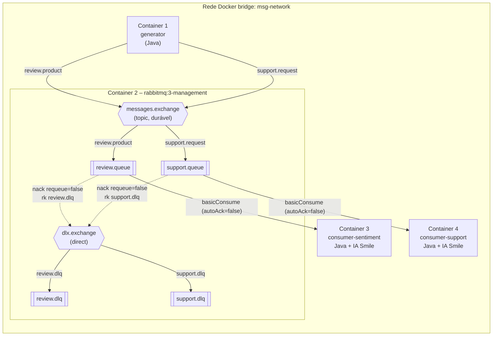

# Classificador Inteligente de Mensagens com RabbitMQ

**Atividade 5 – Sistema Distribuído de Classificação Inteligente de Mensagens com RabbitMQ**

Sistema distribuído em **4 containers Docker** que gera, distribui e classifica mensagens
automaticamente. Um gerador Java publica continuamente avaliações de produtos e solicitações de
suporte em um **Topic Exchange** do RabbitMQ; dois consumidores Java independentes, cada um com
sua própria **IA embarcada (biblioteca Smile)**, consomem filas distintas e classificam o texto.
Mensagens com erro são rejeitadas e vão para **Dead Letter Queues**.

> Guia de demonstração (roteiro do vídeo de 5 minutos): [DEMONSTRACAO.md](DEMONSTRACAO.md)
> Capturas de tela para a entrega: [docs/evidencias/](docs/evidencias/README.md)
> Comandos git por commit: [COMMITS.md](COMMITS.md)

---

## Sumário

1. [Visão geral](#1-visão-geral)
2. [Arquitetura](#2-arquitetura)
3. [Containers](#3-containers)
4. [Topologia do RabbitMQ](#4-topologia-do-rabbitmq)
5. [Formato da mensagem](#5-formato-da-mensagem)
6. [As duas IAs (Smile)](#6-as-duas-ias-smile)
7. [Confiabilidade: ACK manual, DLQ, reconexão e shutdown](#7-confiabilidade-ack-manual-dlq-reconexão-e-shutdown)
8. [Variáveis de ambiente](#8-variáveis-de-ambiente)
9. [Pré-requisitos](#9-pré-requisitos)
10. [Como executar](#10-como-executar)
11. [Logs](#11-logs)
12. [Testes e acurácia](#12-testes-e-acurácia)
13. [Parar e limpar](#13-parar-e-limpar)
14. [Estrutura do repositório](#14-estrutura-do-repositório)
15. [Decisões técnicas](#15-decisões-técnicas)
16. [Troubleshooting](#16-troubleshooting)

---

## 1. Visão geral

| Item | Escolha |
|---|---|
| Linguagem / build | Java 17 + Maven (projeto multi-módulo) |
| Mensageria | RabbitMQ 3.13 (`rabbitmq:3-management`) + `com.rabbitmq:amqp-client` 5.21 |
| JSON / logs | Jackson 2.17 / SLF4J 2 + Logback 1.5 |
| IA | Smile 3.1.1 – `DiscreteNaiveBayes` (multinomial) + `BagOfWords` + utilitários `smile.nlp` |
| Orquestração | Docker Compose, rede bridge `msg-network` |

Fluxo resumido:

1. O **gerador** publica 10 msg/s (configurável, mínimo 5) – ~50% avaliações (`review.product`) e
   ~50% solicitações de suporte (`support.request`).
2. O **Topic Exchange** `messages.exchange` roteia cada mensagem para `review.queue` ou `support.queue`.
3. O **Consumidor 1** lê só `review.queue` e classifica o sentimento (POSITIVA / NEGATIVA / NEUTRA).
4. O **Consumidor 2** lê só `support.queue` e classifica a solicitação (PROBLEMA DE ACESSO /
   DESEMPENHO / CONEXÃO).
5. Os consumidores processam ~1 msg/s (atraso artificial), então **as filas crescem** no painel.
6. Mensagens inválidas recebem `basicNack(requeue=false)` e vão para `review.dlq` / `support.dlq`.

## 2. Arquitetura



Versão ASCII:

```
 rede bridge "msg-network"
 +---------------+        +----------------- Container 2: RabbitMQ -----------------+
 | Container 1   |        |                                                         |
 | generator     |------->|  messages.exchange (topic)                              |
 | 10 msg/s      |        |     | review.product          | support.request         |
 +---------------+        |     v                         v                         |
                          |  review.queue              support.queue                |
                          |     |      \                  /      |                  |
                          |     |  nack(requeue=false)   /       |                  |
                          |     |        v              v        |                  |
                          |     |      dlx.exchange (direct)     |                  |
                          |     |      |rk review.dlq |rk support.dlq               |
                          |     |      v              v          |                  |
                          |     |  review.dlq     support.dlq    |                  |
                          +-----|--------------------------------|------------------+
                                v                                v
                   +------------------------+       +------------------------+
                   | Container 3            |       | Container 4            |
                   | consumer-sentiment     |       | consumer-support       |
                   | IA 1: sentimento       |       | IA 2: suporte          |
                   +------------------------+       +------------------------+
```

## 3. Containers

| # | Serviço (compose) | Imagem | Função |
|---|---|---|---|
| 1 | `generator` | `classificador-mensagens/generator:1.0.0` (build local) | Gera e publica mensagens continuamente; modo opcional de mensagens venenosas. |
| 2 | `rabbitmq` | `rabbitmq:3-management` | Broker + painel em <http://localhost:15672>. Carrega a topologia do `definitions` no boot. |
| 3 | `consumer-sentiment` | `classificador-mensagens/consumer-sentiment:1.0.0` | Consome **só** `review.queue`; IA de sentimento. |
| 4 | `consumer-support` | `classificador-mensagens/consumer-support:1.0.0` | Consome **só** `support.queue`; IA de categorias de suporte. |

- Os 3 serviços Java usam **Dockerfile multi-stage** (build em `maven:3.9-eclipse-temurin-17`,
  runtime em `eclipse-temurin:17-jre-alpine`, usuário não-root). Imagens finais com ~275 MB.
- Todos estão na rede `msg-network` e os serviços Java só sobem depois que o healthcheck do
  RabbitMQ (`rabbitmq-diagnostics -q ping`) fica saudável (`depends_on: condition: service_healthy`).
- `restart: unless-stopped` em todos.

## 4. Topologia do RabbitMQ

| Elemento | Nome | Detalhes |
|---|---|---|
| Exchange principal | `messages.exchange` | `topic`, durável |
| Routing key de avaliações | `review.product` | binding `messages.exchange → review.queue` |
| Routing key de suporte | `support.request` | binding `messages.exchange → support.queue` |
| Fila do Consumidor 1 | `review.queue` | durável, classic, `x-dead-letter-exchange=dlx.exchange`, `x-dead-letter-routing-key=review.dlq` |
| Fila do Consumidor 2 | `support.queue` | durável, classic, `x-dead-letter-exchange=dlx.exchange`, `x-dead-letter-routing-key=support.dlq` |
| Dead Letter Exchange | `dlx.exchange` | `direct`, durável |
| DLQ de avaliações | `review.dlq` | durável; binding `dlx.exchange → review.dlq` (rk `review.dlq`) |
| DLQ de suporte | `support.dlq` | durável; binding `dlx.exchange → support.dlq` (rk `support.dlq`) |

### Fonte única de verdade: `rabbitmq/definitions.template.json`

A topologia é declarada **somente** em [`rabbitmq/definitions.template.json`](rabbitmq/definitions.template.json)
e carregada pelo próprio RabbitMQ no boot. Os serviços Java **não declaram** exchanges nem filas:
apenas verificam que existem com **declarações passivas** (`exchangeDeclarePassive` /
`queueDeclarePassive`, que nunca criam nem alteram nada) e aguardam com retry caso ainda não existam.
Por isso é impossível ocorrer `PRECONDITION_FAILED` por argumentos divergentes entre serviços.

Por que esta abordagem é a mais robusta:

- a topologia existe antes de qualquer cliente conectar (inclusive para mensagens publicadas pela
  API HTTP ou pelo painel);
- mudar um argumento (ex.: DLX) é feito em um único arquivo;
- não há corrida entre serviços para declarar filas.

Detalhe importante: quando há definições para carregar no boot, o RabbitMQ **não cria** o usuário
padrão (`RABBITMQ_DEFAULT_USER`). Para não deixar credenciais em arquivo, o container usa como
entrypoint [`rabbitmq/render-definitions.sh`](rabbitmq/render-definitions.sh), que gera
`/etc/rabbitmq/definitions.json` juntando o usuário/senha do `.env` (`RABBITMQ_USER`/`RABBITMQ_PASS`)
com o template da topologia e depois chama o entrypoint oficial da imagem. O
[`rabbitmq/rabbitmq.conf`](rabbitmq/rabbitmq.conf) aponta `definitions.local.path` para esse arquivo.

## 5. Formato da mensagem

```json
{
  "id": "6f1c2a1e-6b0e-4f7e-9a51-0f5d2c8b9e11",
  "timestamp": "2026-10-12T23:14:12.491-03:00",
  "type": "review",
  "content": "Avaliação sincera: A luminária é simplesmente muito boa! Vale cada centavo investido. Recomendo!"
}
```

| Campo | Descrição |
|---|---|
| `id` | UUID único (também enviado na propriedade AMQP `message_id`) |
| `timestamp` | data/hora de geração em ISO-8601 com offset |
| `type` | `review` (avaliação) ou `support` (solicitação de suporte) |
| `content` | texto em português |

Propriedades AMQP: `delivery_mode=2` (persistente), `content_type=application/json`,
`content_encoding=UTF-8`, `message_id`, `type`, `timestamp`, `app_id=generator`. O gerador usa
**publisher confirms** e `mandatory=true` (mensagens sem rota seriam devolvidas e logadas).

Os textos são montados combinando partes (abertura + frase principal com produto/sistema e
adjetivo com concordância de gênero + comentário + fechamento): 38 produtos, 14 sistemas e dezenas
de frases por classe, o que gera dezenas de milhares de combinações (em um teste com 1.000 mensagens,
mais de 90% dos textos são distintos).

## 6. As duas IAs (Smile)

Cada consumidor tem o **seu próprio classificador**, com dataset próprio, treinado no startup dentro
do próprio container. Não há chamadas a APIs externas nem acesso à internet em tempo de execução.

| | IA 1 – `SentimentClassifier` | IA 2 – `SupportClassifier` |
|---|---|---|
| Container | `consumer-sentiment` | `consumer-support` |
| Classes | POSITIVA, NEGATIVA, NEUTRA | PROBLEMA DE ACESSO, PROBLEMA DE DESEMPENHO, PROBLEMA DE CONEXÃO |
| Dataset | [`sentiment-pt.csv`](consumer-sentiment/src/main/resources/dataset/sentiment-pt.csv) – 250 exemplos (80 / 89 / 81) | [`support-pt.csv`](consumer-support/src/main/resources/dataset/support-pt.csv) – 240 exemplos (80 / 80 / 80) |
| Vocabulário | 565 termos (unigramas + bigramas) | 543 termos |
| Validação cruzada estratificada 5-fold (dataset) | **87,2%** | **97,1%** |
| Acurácia sobre 3.000 mensagens do gerador | **99,47%** | **99,37%** |
| Tempo de treino no container | ~0,6 s | ~0,6 s |

Interface das classes (cada IA em sua própria classe):

```java
public interface TextClassifier {
    String classify(String texto);   // "POSITIVA" / "PROBLEMA DE CONEXÃO" ...
}
// + Prediction<L> predict(String texto) -> classe, confiança (probabilidade a posteriori) e distribuição
```

### Biblioteca e versão

- **Smile 3.1.1** (`com.github.haifengl:smile-core` e `smile-nlp`). É bytecode Java 8, compatível com
  Java 17. (Smile 4.x exige Java 21 e mudou várias APIs; por isso fixamos a 3.1.1.)
- APIs usadas (conferidas com `javap` nos jars da versão fixada):
  - `smile.nlp.normalizer.SimpleNormalizer` – normalização Unicode/espaços/aspas;
  - `smile.nlp.tokenizer.SimpleTokenizer` – tokenização;
  - `smile.feature.extraction.BagOfWords(Function<String,String[]>, String[])` – vetorização bag-of-words;
  - `smile.classification.DiscreteNaiveBayes(Model.MULTINOMIAL, k, p, sigma, IntSet)` + `update(int[][], int[])`
    + `predict(int[], double[] posteriori)` – classificador;
  - `smile.validation.metric.Accuracy` e `ConfusionMatrix` – métricas da validação cruzada.
- **Dependências nativas:** o `smile-core` 3.1.1 puxa OpenBLAS/ARPACK nativos (`org.bytedeco`) para 4
  plataformas (centenas de MB). Como o Naive Bayes, o BagOfWords e os utilitários de NLP são 100% Java,
  esses artefatos são **excluídos** no `pom.xml` – sem risco de erro de biblioteca nativa no Alpine e
  com imagens bem menores.

### Pipeline de pré-processamento ([`TextPreprocessor`](common/src/main/java/br/sd/classificador/common/nlp/TextPreprocessor.java))

1. Normalização com `SimpleNormalizer` (Smile);
2. minúsculas e remoção de acentos (NFD + remoção de diacríticos);
3. remoção de pontuação e de números;
4. tokenização com `SimpleTokenizer` (Smile);
5. remoção de stopwords em português ([lista própria](common/src/main/resources/nlp/stopwords-pt.txt)),
   **preservando** negações e intensificadores (`não`, `nem`, `nada`, `sem`, `muito`, `mas`...), que
   mudam o sentido da frase;
6. stemming leve (remove plural e vogal final: `ótimas → otim`, `lenta → lent`);
7. bigramas de tokens vizinhos (`não recomendo → nao_recomend`), para capturar negações.

### Algoritmo

Naive Bayes **multinomial** com suavização de Laplace (σ = 1) sobre contagens bag-of-words. É o
algoritmo clássico para textos curtos: treina em milissegundos, funciona bem com poucos exemplos e
devolve probabilidades a posteriori, exibidas como "confiança" no log. Quando um texto não tem nenhum
termo conhecido, o Smile devolve um índice inválido; nesse caso o modelo usa a probabilidade a priori.

### Datasets

Frases escritas à mão em português, com vocabulário próximo ao de avaliações/chamados reais e ao do
gerador, mas **sem copiar os templates** do gerador (outros produtos, outras construções), para que o
modelo precise generalizar. Formato `ROTULO;texto`, um exemplo por linha.

### Acurácia

- **Validação cruzada estratificada 5-fold** sobre o dataset (logada no startup de cada consumidor,
  com matriz de confusão). Sentimento: 87,2%; suporte: 97,1%.
- **Mensagens do próprio gerador** (módulo `evaluation`, 1.000 mensagens por classe, 3.000 por IA,
  rótulo verdadeiro = classe do template usado): sentimento **99,47%**, suporte **99,37%**.

Matriz de confusão sobre mensagens do gerador:

| Sentimento (real ↓ / previsto →) | POSITIVA | NEGATIVA | NEUTRA |
|---|---|---|---|
| POSITIVA | 998 | 0 | 2 |
| NEGATIVA | 5 | 989 | 6 |
| NEUTRA | 0 | 3 | 997 |

| Suporte (real ↓ / previsto →) | ACESSO | DESEMPENHO | CONEXÃO |
|---|---|---|---|
| ACESSO | 990 | 10 | 0 |
| DESEMPENHO | 6 | 994 | 0 |
| CONEXÃO | 3 | 0 | 997 |

### Limitações

- Bag-of-words ignora ordem/estrutura além de bigramas: ironia ("que maravilha, quebrou no 1º dia")
  e negações longas podem enganar o modelo.
- A classe NEUTRA é a mais difícil (mistura termos positivos e negativos: "nem bom nem ruim"); por isso
  a acurácia por validação cruzada do sentimento (87%) é menor que a do suporte.
- Palavras que aparecem em várias classes puxam a decisão: por exemplo "mouse **sem** fio" (a palavra
  `sem` é frequente em avaliações neutras, como "sem surpresas") e "abrir os **relatórios**" (frequente
  em chamados de desempenho) explicam a maior parte dos poucos erros sobre mensagens do gerador.
- O dataset é pequeno (~80 exemplos por classe) e o vocabulário fora dele é ignorado; textos de
  outros domínios terão acurácia menor que a medida sobre o gerador.
- As probabilidades do Naive Bayes costumam ser "otimistas" (confiança perto de 100%).

## 7. Confiabilidade: ACK manual, DLQ, reconexão e shutdown

- **ACK manual**: `basicConsume(queue, autoAck=false, ...)`; `basicAck` só depois de validar, aplicar o
  atraso artificial e classificar com sucesso.
- **Prefetch pequeno**: `basicQos(PREFETCH_COUNT)` (padrão 1) – as mensagens ficam *Ready* na fila
  (visíveis no painel) e não no buffer do consumidor. No painel aparece `Unacked = 1` por fila.
- **Atraso artificial**: `PROCESSING_DELAY_MS` (padrão 1000 ms). Com 10 msg/s (≈5/s por fila) e cada
  consumidor processando ≈1/s, cada fila cresce ≈4 msg/s.
- **Erros → DLQ**: JSON inválido, campo obrigatório ausente/vazio, `id` que não é UUID, `timestamp`
  fora de ISO-8601, `type` errado para a fila, `content == "__POISON__"` ou exceção na IA →
  `basicNack(deliveryTag, false, requeue=false)`. O RabbitMQ encaminha para o `dlx.exchange`, que
  entrega em `review.dlq`/`support.dlq` e adiciona o header `x-death` (fila de origem, motivo
  `rejected`, contagem, horário). O consumidor loga
  `ERRO -> enviada para DLQ | fila=... | id=... | motivo=... | corpo=...`. Se o JSON for inválido, o
  id vem da propriedade AMQP `message_id`.
- **Mensagens venenosas**: `POISON_EVERY_N` no gerador (alterna `__POISON__` e JSON inválido entre as
  duas filas) e os scripts [`scripts/send-poison.ps1`](scripts/send-poison.ps1) /
  [`scripts/send-poison.sh`](scripts/send-poison.sh), que publicam uma mensagem sob demanda pela API
  HTTP (`POST /api/exchanges/%2F/messages.exchange/publish`).
- **Reconexão**: na inicialização, retry com backoff exponencial (1 s, 2 s, 4 s ... até 15 s) até o
  broker aceitar conexões e a topologia existir. Depois de conectado, a recuperação automática do
  `amqp-client` restabelece conexão, canal, QoS e consumidor se o broker cair.
- **Shutdown gracioso**: no `SIGTERM` (`docker compose stop`) o consumidor cancela o consumo, espera a
  mensagem em andamento terminar (e ser confirmada), fecha canal e conexão e loga o total processado.
  Mensagens não confirmadas voltam para a fila automaticamente. O gerador para o agendador e fecha
  a conexão.
- **Persistência**: filas duráveis + mensagens persistentes + volume `rabbitmq-data`: o backlog
  sobrevive a reinícios do RabbitMQ.

## 8. Variáveis de ambiente

Todas têm valor padrão no `docker-compose.yml`; o `.env` é opcional (copie de [`.env.example`](.env.example)).

| Variável | Padrão | Usada por | Descrição |
|---|---|---|---|
| `RABBITMQ_USER` | `admin` | todos | Usuário do RabbitMQ (painel e AMQP) |
| `RABBITMQ_PASS` | `admin123` | todos | Senha do RabbitMQ |
| `RABBITMQ_AMQP_PORT` | `5672` | rabbitmq | Porta AMQP publicada no host |
| `RABBITMQ_MANAGEMENT_PORT` | `15672` | rabbitmq | Porta do painel publicada no host |
| `MESSAGES_PER_SECOND` | `10` | generator | Taxa de geração (mínimo exigido: 5) |
| `REVIEW_RATIO` | `0.5` | generator | Fração de avaliações (0.5 = 50%/50%) |
| `POISON_EVERY_N` | `0` | generator | A cada N mensagens envia uma venenosa (0 = desligado) |
| `LOG_EACH_MESSAGE` | `true` | generator | Loga cada mensagem (além do resumo por segundo) |
| `PROCESSING_DELAY_MS` | `1000` | consumidores | Atraso artificial por mensagem |
| `PREFETCH_COUNT` | `1` | consumidores | Máximo de mensagens não confirmadas por consumidor |
| `TZ` | `America/Sao_Paulo` | todos | Fuso horário dos logs e do `timestamp` |
| `LOG_LEVEL` | `INFO` | serviços Java | Nível de log (Logback) |

Variáveis avançadas (sem precisar mudar o compose, via `environment`): `RABBITMQ_HOST`, `RABBITMQ_PORT`,
`RABBITMQ_VHOST`, `CONNECT_MAX_ATTEMPTS` (0 = infinito), `CONNECT_INITIAL_BACKOFF_MS`,
`CONNECT_MAX_BACKOFF_MS`, `GENERATOR_SEED`.

## 9. Pré-requisitos

- **Docker** com **Docker Compose v2** (Docker Desktop no Windows/macOS, ou Docker Engine no Linux).
  Testado com Docker 29 / Compose v5 no Windows 11 (backend WSL 2).
- Portas **5672** e **15672** livres (ou altere no `.env`).
- ~1,5 GB de RAM livre para os 4 containers.
- **Não** é preciso ter Java nem Maven instalados: o build acontece dentro dos containers.
  (Opcional, para rodar testes: Docker, via `scripts/mvn-docker.ps1`; ou JDK 17 + Maven 3.9.)

## 10. Como executar

```bash
# 1. (opcional) configurar credenciais/taxas
cp .env.example .env            # PowerShell: Copy-Item .env.example .env

# 2. subir tudo (primeira vez leva alguns minutos baixando imagens e dependências Maven)
docker compose up --build       # ou: docker compose up --build -d  (em segundo plano)

# 3. conferir
docker compose ps               # rabbitmq deve aparecer "(healthy)" e os outros "Up"
```

Painel do RabbitMQ: <http://localhost:15672> – usuário `admin`, senha `admin123` (ou os do seu `.env`).

Demonstrar a DLQ (com o ambiente no ar):

```powershell
.\scripts\send-poison.ps1                        # Windows (PowerShell): review.queue -> review.dlq
.\scripts\send-poison.ps1 -Target support -Kind invalid-json
```

```bash
./scripts/send-poison.sh review poison           # Linux/macOS/Git Bash
./scripts/send-poison.sh support missing-field
```

A fila é FIFO: a mensagem venenosa só chega ao consumidor depois do backlog. Para vê-la na hora,
purgue a fila antes (painel: *Queues > review.queue > Purge Messages*). Detalhes no
[DEMONSTRACAO.md](DEMONSTRACAO.md).

## 11. Logs

```bash
docker compose logs -f generator            # gerador: [PUBLICADO] ... e [RESUMO] N msg/s
docker compose logs -f consumer-sentiment   # IA 1: [IA-SENTIMENTO] id=... classificação=... confiança=...
docker compose logs -f consumer-support     # IA 2: [IA-SUPORTE] id=... categoria=...
docker compose logs -f rabbitmq
docker compose logs -f consumer-sentiment consumer-support   # os dois consumidores juntos
```

Exemplo real (Consumidor 1):

```
23:14:12.704 INFO  [SentimentConsumerApp] [IA-SENTIMENTO] id=b3fba0f3-8473-49b7-9a81-31dbdaf87864 | classificação=NEUTRA | confiança=99,7% | texto="Uso a mochila todos os dias. Achei a mochila aceitável. Não me impressionou, mas também não decepcionou. Três estrelas."
23:14:12.705 INFO  [ManualAckConsumer] ACK manual enviado | id=b3fba0f3-8473-49b7-9a81-31dbdaf87864 | sentimento=NEUTRA | processadas=16 | rejeitadas(DLQ)=0
```

Exemplo real de erro (Consumidor 2):

```
23:16:10.171 ERROR [ManualAckConsumer] ERRO -> enviada para DLQ | fila=support.queue | id=879476e1-95b6-40e0-9c52-d50198ded662 | motivo=JSON inválido: Unrecognized token 'isto': ... | corpo={"id":"879476e1-...","type":"support","content": isto nao e um JSON valido | total rejeitadas=1
```

## 12. Testes e acurácia

41 testes JUnit 5:

| Módulo | Testes |
|---|---|
| `common` | `MessageCodecTest` (JSON válido/inválido, campo ausente, `__POISON__`, tipo errado, UUID/timestamp inválidos), `TextPreprocessorTest` |
| `generator` | `MessageFactoryTest` (4 campos obrigatórios, UUID único, ISO-8601, routing keys, proporção 50/50, variedade de textos, `POISON_EVERY_N`) |
| `consumer-sentiment` | `SentimentClassifierTest` (frases claramente positivas/negativas/neutras, probabilidades, tamanho do dataset, validação cruzada) |
| `consumer-support` | `SupportClassifierTest` (solicitações claras de cada categoria, dataset, validação cruzada) |
| `evaluation` | `GeneratedMessagesAccuracyTest` (acurácia das duas IAs sobre 3.000 mensagens do gerador cada, mínimo exigido 90%) |

Rodar sem ter Maven instalado (usa um container `maven:3.9-eclipse-temurin-17`):

```powershell
.\scripts\mvn-docker.ps1                      # mvn -B clean package (compila + todos os testes)
.\scripts\mvn-docker.ps1 -B test -pl evaluation -am   # só a medição de acurácia
```

```bash
./scripts/mvn-docker.sh                       # Linux/macOS/Git Bash
# ou, com JDK 17 + Maven instalados:
mvn clean package
```

O relatório de acurácia é impresso no console e salvo em `evaluation/target/accuracy-report.txt`.

## 13. Parar e limpar

```bash
docker compose stop                 # para os containers (mantém filas e mensagens)
docker compose start                # volta a subir
docker compose down                 # remove containers e rede (mantém o volume do RabbitMQ)
docker compose down -v              # remove também o volume: filas zeradas na próxima subida
docker compose down -v --rmi local  # e ainda remove as imagens construídas localmente
```

## 14. Estrutura do repositório

```
.
├── pom.xml                         # POM pai (multi-módulo, versões fixadas, exclusões do Smile)
├── docker-compose.yml              # 4 serviços, rede msg-network, healthcheck, depends_on
├── .env.example  .gitignore  .dockerignore  .gitattributes
├── rabbitmq/
│   ├── definitions.template.json   # FONTE ÚNICA da topologia (exchanges, filas, DLX, DLQs, bindings)
│   ├── rabbitmq.conf               # aponta o RabbitMQ para o definitions.json gerado
│   └── render-definitions.sh       # entrypoint: injeta usuário do .env + topologia e inicia o broker
├── common/                         # código compartilhado pelos 3 serviços
│   └── src/main/java/br/sd/classificador/common/
│       ├── Topology.java  Env.java
│       ├── message/   Message, MessageCodec (validação), InvalidMessageException
│       ├── rabbit/    RabbitConfig, RabbitConnector (retry/backoff + verificação passiva da topologia)
│       ├── consumer/  ConsumerRunner, ManualAckConsumer (ACK manual / NACK -> DLQ), ConsumerSettings, MessageProcessor
│       └── nlp/       TextPreprocessor, NaiveBayesTextModel (Smile), ModelEvaluation, LabeledDataset, Prediction, TextClassifier
├── generator/                      # Container 1
│   ├── Dockerfile
│   └── src/main/java/br/sd/classificador/generator/
│       ├── GeneratorApp, GeneratorConfig, MessageFactory, MessagePublisher, OutgoingMessage
│       └── templates/ ReviewTemplates, SupportTemplates, Noun, Adjective, TextTemplates
├── consumer-sentiment/             # Container 3
│   ├── Dockerfile
│   └── src/main/{java/.../sentiment/{SentimentConsumerApp, SentimentClassifier, Sentiment}, resources/dataset/sentiment-pt.csv}
├── consumer-support/               # Container 4
│   ├── Dockerfile
│   └── src/main/{java/.../support/{SupportConsumerApp, SupportClassifier, SupportCategory}, resources/dataset/support-pt.csv}
├── evaluation/                     # só testes: acurácia das IAs sobre mensagens do gerador
├── scripts/
│   ├── send-poison.ps1  send-poison.sh   # publica 1 mensagem com erro via API HTTP (demo DLQ)
│   └── mvn-docker.ps1   mvn-docker.sh    # Maven dentro de container
├── docs/evidencias/README.md       # checklist das capturas de tela
├── DEMONSTRACAO.md                 # guia de uso e roteiro do vídeo
└── COMMITS.md                      # comandos git por commit
```

## 15. Decisões técnicas

- **Java 17 + Smile 3.1.1**: a linha 3.x é estável, roda em Java 8+ e tem as APIs de NLP/Naive Bayes
  necessárias. A 4.x exigiria Java 21 e tem outra API.
- **Naive Bayes multinomial** em vez de regressão logística/SVM: não depende de BLAS/LAPACK nativos,
  treina em ~0,6 s, dá probabilidades e tem ótima acurácia em textos curtos.
- **Treino no startup** a partir do CSV embutido (em vez de modelo serializado): o dataset fica
  legível/auditável no repositório e o log mostra a acurácia a cada subida.
- **Multi-módulo Maven com `common`**: modelo de mensagem, conexão, consumidor com ACK manual e
  pipeline de NLP são escritos uma vez. Cada consumidor continua com **seu próprio classificador,
  dataset, rótulos e modelo treinado no seu container**. O gerador exclui o Smile do seu jar.
- **Módulo `evaluation`**: mede a acurácia sobre mensagens do gerador sem criar dependência dos
  consumidores em relação ao gerador.
- **Topologia via definitions + declarações passivas nos serviços**: fonte única, sem
  `PRECONDITION_FAILED`.
- **DLX `direct` com routing keys explícitas** (`x-dead-letter-routing-key`): cada fila principal
  manda para a sua DLQ, mesmo compartilhando um único DLX.
- **Publisher confirms + `mandatory`** no gerador: nenhuma mensagem é perdida silenciosamente.
- **`waitForConfirms` (não `...OrDie`)**: um nack isolado não derruba o canal do publicador.

## 16. Troubleshooting

| Sintoma | Causa provável / solução |
|---|---|
| `Bind for 0.0.0.0:5672 failed: port is already allocated` | Outro RabbitMQ rodando. Pare-o ou mude `RABBITMQ_AMQP_PORT`/`RABBITMQ_MANAGEMENT_PORT` no `.env`. |
| Serviços logam `RabbitMQ indisponível ... Nova tentativa` | Normal nos primeiros segundos; eles conectam sozinhos quando o broker termina o boot. |
| `ACCESS_REFUSED - Login was refused` | Usuário/senha diferentes entre os serviços e o broker. Confira o `.env` e recrie: `docker compose up -d --force-recreate`. |
| Não consigo logar no painel | Use as credenciais do `.env` (padrão `admin`/`admin123`). O usuário `guest` não existe neste setup. |
| `Topologia ainda não disponível` | O definitions não foi carregado. Veja `docker compose logs rabbitmq` (procure `Importing`) e se a pasta `rabbitmq/` foi montada. |
| Erro `/bin/sh^M` ou `set: Illegal option -` | Final de linha CRLF em script. O compose já remove `\r` do entrypoint; para `send-poison.sh` rode `sed -i 's/\r$//' scripts/*.sh`. |
| `send-poison.ps1 não pode ser carregado` | Política de execução: `powershell -ExecutionPolicy Bypass -File .\scripts\send-poison.ps1`. |
| A mensagem venenosa não aparece na DLQ | A fila é FIFO e tem backlog; purgue a fila antes ou aguarde. Veja [DEMONSTRACAO.md](DEMONSTRACAO.md). |
| Build lento na primeira vez | Download das imagens e dependências Maven; os próximos builds usam cache. |
| Acentos estranhos no console do Windows | Use o Windows Terminal ou rode `chcp 65001` antes de `docker compose logs`. |
| Filas muito grandes / memória | `docker compose exec rabbitmq rabbitmqctl purge_queue review.queue` ou `docker compose down -v`. |
